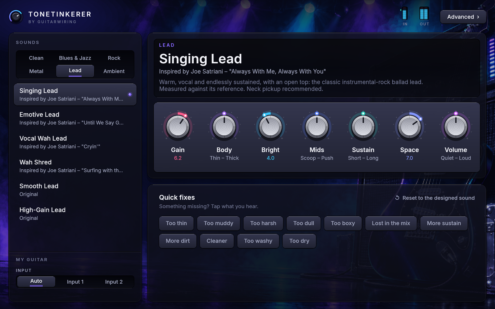
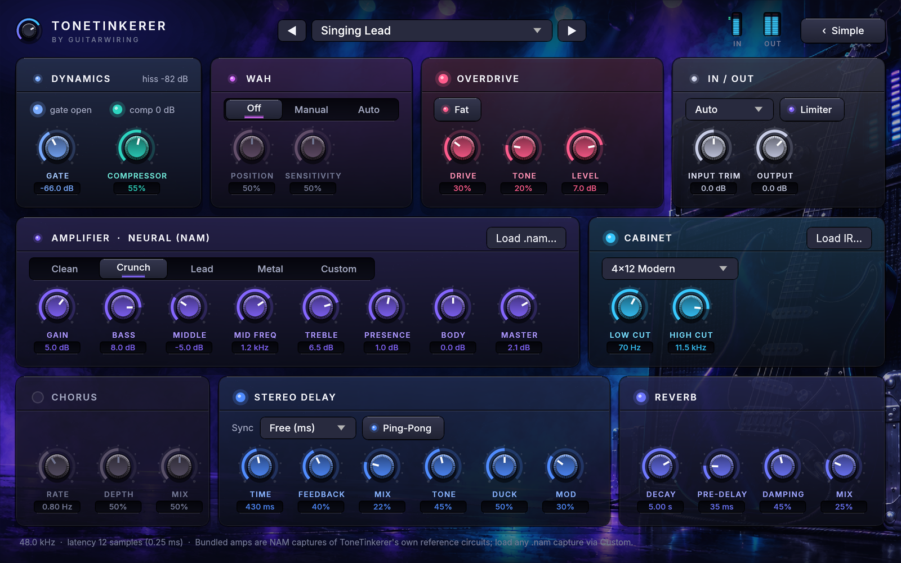

# ToneTinkerer

A free guitar amp simulator plugin (VST3 and CLAP) by
[GuitarWiring](https://guitarwiring.app/). Plug in, pick what you play, and
play. We tinker so you don't have to.



The idea is to play first and only change settings when something is missing.

There are 23 sounds across Clean, Blues & Jazz, Rock, Metal, Lead and Ambient.
Each one is a complete rig with pedals, amp, cabinet and effects, and they are
level-matched, so switching sounds never jumps in volume.

The main screen has seven knobs with plain names: Gain, Body, Bright, Mids,
Sustain, Space and Volume. In the centre position a knob leaves the sound as
designed, and turning it moves several settings underneath at once. Below them
are one-tap fixes named after what you hear: Too thin, Too muddy, Too harsh,
Too dull, Too boxy, Lost in the mix, More sustain, More dirt, Cleaner, Too
washy and Too dry.

The sounds are level-matched for a guitar arriving at a typical level
(peaks around -18 dBFS), so clean and high-gain sounds play at about the same
volume. The plugin never turns your input up before the amps. If your guitar
arrives much hotter or quieter, Input Trim in the Advanced view adjusts it. The
noise gate measures your input's own hiss in pauses and closes just above it.

The Advanced view has every setting: noise gate, compressor, wah, overdrive,
four neural amp models, five cabinets, EQ, chorus, delay and reverb.

<details>
<summary>Advanced view screenshot</summary>



</details>

The rock, metal and lead sounds play through two real miked 4x12 cabinets,
a modern one and a classic British one. They are free CC0 recordings by
[Jester Dyne Productions](https://jester-dyne-productions.com). The cleans
and ambient sounds use synthesized cabinets.

Under the hood: Neural Amp Modeler inference ([nam-rs](https://crates.io/crates/nam-rs)),
partitioned-convolution cabinets, [nice-plug](https://codeberg.org/RustAudio/nice-plug)
and egui, all in Rust. Latency at 48 kHz is 12 samples (0.25 ms).

## The sounds

| Genre | Sound | Inspired by |
|---|---|---|
| Clean | Studio Clean | |
| | Funk Clean | classic funk and disco rhythm guitar |
| | 80s Chorus Clean | 1980s pop and rock clean tones |
| Blues & Jazz | Jazz Clean | Wes Montgomery, "Four On Six" |
| | Smooth Jazz Clean | George Benson, "Breezin'" |
| | Blues Breakup | classic electric blues (B.B. King style) |
| | Blues Lead | Eric Clapton, "Before You Accuse Me" |
| | Blues-Rock Lead | Cream, "Crossroads" (1968) |
| Rock | Classic Crunch | classic 70s British rock rhythm |
| | Hard Rock | 80s hard rock rhythm and lead |
| | Rhythm Crunch | |
| Metal | Thrash Rhythm | Metallica, "Master of Puppets" |
| | Modern Metal | Lamb of God, "Laid to Rest" |
| | Heavy Riff | Metallica, "Some Kind of Monster" |
| | Metal Lead | |
| Lead | Singing Lead | Joe Satriani, "Always With Me, Always With You" |
| | Emotive Lead | Joe Satriani, "Until We Say Goodbye" |
| | Vocal Wah Lead | Joe Satriani, "Cryin'" |
| | Wah Shred | Joe Satriani, "Surfing with the Alien" |
| | Smooth Lead, High-Gain Lead | |
| Ambient | Ambient Lead, Dreamy Swells | |

"Inspired by" describes the character a sound aims for. Sounds are original
settings of this plugin, not reproductions of any artist's rig or recording.
Sounds with a song reference were voiced by measuring the guitar in that
recording (see IMPLEMENTATION_PLAN.md); the recordings themselves are never
part of this project.

## Download and install

The quickest way is one line. It downloads the latest release and puts both
plugins (VST3 and CLAP) in the right folders.

- Mac or Linux: open Terminal, paste this and press Enter.
  ```bash
  curl -fsSL https://raw.githubusercontent.com/Tinkercaster/tonetinkerer/main/scripts/install.sh | bash
  ```
- Windows: open PowerShell, paste this and press Enter. Windows asks once for
  administrator rights, because plugins live in Program Files.
  ```powershell
  irm https://raw.githubusercontent.com/Tinkercaster/tonetinkerer/main/scripts/install.ps1 | iex
  ```

Then restart your DAW (or rescan plugins). In REAPER it appears as
"VST3: ToneTinkerer (GuitarWiring)" and "CLAP: ToneTinkerer".

You can also download a release yourself from
[Releases](https://github.com/Tinkercaster/tonetinkerer/releases/latest).
Each download has both plugins and a `README.txt` with the steps.

| Your computer | Download | Copy the plugins to |
|---|---|---|
| Mac (Apple silicon or Intel) | `ToneTinkerer-macOS.zip` | `~/Library/Audio/Plug-Ins/VST3/` and `~/Library/Audio/Plug-Ins/CLAP/` |
| Windows 10/11 (64-bit) | `ToneTinkerer-Windows.zip` | `C:\Program Files\Common Files\VST3\` and `...\CLAP\` |
| Linux (x86_64) | `ToneTinkerer-Linux.tar.gz` | `~/.vst3/` and `~/.clap/` |

The plugins are not signed by Apple. On a Mac, a copy you downloaded by hand
needs this command once in Terminal. The one-line installer doesn't need it.

```bash
xattr -dr com.apple.quarantine ~/Library/Audio/Plug-Ins/VST3/ToneTinkerer.vst3 ~/Library/Audio/Plug-Ins/CLAP/ToneTinkerer.clap
```

### Build it yourself

```bash
cargo xtask bundle tonetinkerer-plugin --release          # or bundle-universal on macOS
cp -R target/bundled/ToneTinkerer.vst3 ~/Library/Audio/Plug-Ins/VST3/
cp -R target/bundled/ToneTinkerer.clap ~/Library/Audio/Plug-Ins/CLAP/
```

`scripts/build-macos-pkg.sh` builds a macOS installer at
`target/installer/ToneTinkerer.pkg`. It is unsigned unless `SIGN_APP` and
`SIGN_PKG` name your Developer ID certificates, and the script has the
notarization steps. Releases come from
[.github/workflows/release.yml](.github/workflows/release.yml), which runs when
a `v*` tag is pushed.

## Playing through it

Any audio interface works.

1. Plug the guitar into the interface's instrument (Hi-Z) input.
2. In the DAW, make a track with that input, record-arm it, turn input
   monitoring on and add ToneTinkerer as its first effect. 48 kHz with a buffer
   of 64 to 128 samples works best.
3. Pick a sound and play. If something is missing, turn a knob or tap a fix.

On macOS you can use one device for input and another for output, for example
an interface in and laptop speakers out. Create an Aggregate Device in Audio
MIDI Setup and select it in the DAW.

## Your own amps, cabinets and artwork

In the Advanced view, "Load .nam…" loads any NAM capture as the amp and "Load
IR…" loads any impulse-response `.wav` as the cabinet. To change the
background, put artwork at `assets/skin/background.png` (1120x700 or larger)
and rebuild.

## Windows (including WSL2 development)

Cross-build the Windows plugin from WSL2 or macOS with the open-source
MinGW-w64 toolchain (`sudo apt install mingw-w64` / `brew install mingw-w64`):

```bash
rustup target add x86_64-pc-windows-gnu
scripts/build-windows.sh            # -> target/bundled-windows/ToneTinkerer.{vst3,clap}
```

Copy the results to `C:\Program Files\Common Files\VST3` and `...\CLAP`. A plugin
compiled natively inside WSL2 is a Linux plugin and won't load in a Windows DAW,
so use the cross-build. The Windows build compiles, exports the VST3 and CLAP
entry points and imports only DLLs that ship with Windows 10 and 11. Nobody has
played through it on a Windows machine yet.

## Development

See [ARCHITECTURE.md](ARCHITECTURE.md), [IMPLEMENTATION_PLAN.md](IMPLEMENTATION_PLAN.md),
[AGENTS.md](AGENTS.md), [ASSETS.md](ASSETS.md), [docs/BENCHMARKS.md](docs/BENCHMARKS.md)
and [THIRD_PARTY_NOTICES.md](THIRD_PARTY_NOTICES.md). `cargo test` also writes
screenshots of every editor screen to `target/snapshots/`.

```bash
cargo test                                            # DSP, macros, offline-render, lifecycle, real-time safety
cargo bench -p tonetinkerer-dsp                       # CPU and latency
cargo run --release -p tonetinkerer-render -- demos render-out/demos   # render every sound
cargo run --release -p tonetinkerer-render -- levels  # loudness of every sound
cargo run --release -p tonetinkerer-plugin --features standalone --bin tonetinkerer-standalone -- -b dummy  # GUI without a DAW
```

## License

ToneTinkerer is open source under the [MIT License](LICENSE). Third-party
components keep their own licences, all of them permissive (see
[THIRD_PARTY_NOTICES.md](THIRD_PARTY_NOTICES.md)). The bundled Inter font is
under the SIL Open Font License 1.1, and the two recorded cabinet IRs are CC0
(see [ASSETS.md](ASSETS.md)).
